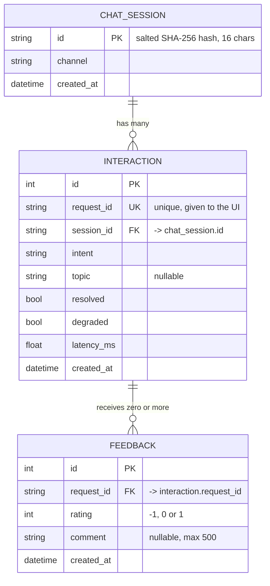

# Lab 5 — Data model worksheet

## 1. Critique the bad schema (sql/bad_schema.sql)
| # | Problem | Why it hurts | Fix |
|---|---|---|---|
| 1 | No primary key, no constraints | `id` is not declared unique or NOT NULL, so duplicate IDs, NULLs and orphan rows are allowed and rows cannot be reliably identified | `id INTEGER PRIMARY KEY`; add NOT NULL, CHECK and FOREIGN KEY constraints |
| 2 | Student name and phone repeated in every row | Redundancy and update anomalies: one change needs many row updates, and missed rows leave contradictory copies | Separate `students` table; `chats` references it by `student_id` |
| 3 | Real names and phone numbers stored with every message | Unnecessary personal data; maximizes privacy exposure and breach impact | Store an opaque pseudonym; keep contact details only if required, in a restricted table |
| 4 | Raw messages kept forever | Messages may contain personal data; indefinite retention has no purpose | Define a retention period; redact or purge after it expires |
| 5 | `intent` is free text | 'fee', 'Fee', 'FEE', 'tuition' count as separate values, so GROUP BY gives wrong totals | `intents` lookup table with `intent_id` foreign key, or a CHECK on allowed values |
| 6 | `time` stored as ambiguous text | '5/10/2026' is ambiguous (May 10 or 5 October); text sorts alphabetically, breaking range queries; no timezone | ISO 8601 UTC in `created_at` (`'2026-10-05T14:03:00Z'`) |

## 2. Store or not? (privacy-aware storage)
| Data | Store? | Form (raw / hashed / aggregated / none) | Retention | Reason |
|---|---|---|---|---|
| raw user message | Short-term only | Raw, PII-redacted | 30 days, then purge (keep only intent) | Free text can contain names, phones, health or personal details; analytics need the intent, not the text; short-term copy is only for debugging |
| session id | Yes | Hashed (random token, not derived from identity) | 90 days | Groups messages into conversations and counts sessions without identifying the student |
| intent, latency, topic | Yes | Raw (not personal data) | 12 months, then aggregated | Core analytics; low risk; supports performance and demand tracking |
| feedback rating | Yes | Raw, linked to chat | 12 months, then aggregated | Needed to measure answer quality; a number carries no personal content |
| feedback comment | Only if optional and opted in | Raw, PII-redacted | 90 days, or aggregate into themes | Free text has the same PII risk as messages; retain only until reviewed |
| student name / phone | No | None | Not stored | Not needed for any analytic purpose; link chats via pseudonym instead |

## 3. Product questions → fields
| Product question | Fields needed | Table(s) | Query sketch |
|---|---|---|---|
| Most failed intent? |intent, resolved |interaction |SELECT intent, COUNT(*) AS failed FROM interaction WHERE resolved = 0 GROUP BY intent ORDER BY failed DESC LIMIT 1; |
| Average response time by intent? |intent, latency_ms |interaction	 | SELECT intent, ROUND(AVG(latency_ms), 1) AS avg_ms FROM interaction GROUP BY intent ORDER BY avg_ms DESC;|
| Top unresolved topics? |topic, resolved |interaction |SELECT topic, COUNT(*) AS unresolved FROM interaction WHERE resolved = 0 AND topic IS NOT NULL GROUP BY topic ORDER BY unresolved DESC LIMIT 5; |

## 4. ER diagram
Draw entities, keys and relationships (photo or Mermaid in docs/data-model.md).
