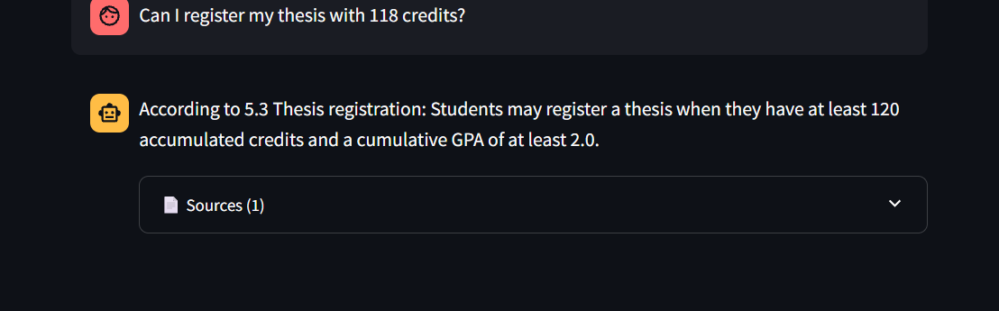
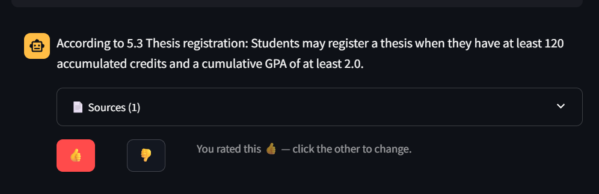

# Lab 7 homework — 10-minute usability test

Tester (not in your team, first name only): Duy, Date: 20/11/2026
Task you gave them: "Find out if you can register your thesis with 118 credits, and where to replace a lost student card."

Rule: do not help or explain. Watch and write down what happens.

| # | What the tester did or said                                                 | What they expected                                       | Why the system/UI caused it                                                                                                                                                      | Fix idea                                                                                                                               |
| - | --------------------------------------------------------------------------- | -------------------------------------------------------- | -------------------------------------------------------------------------------------------------------------------------------------------------------------------------------- | -------------------------------------------------------------------------------------------------------------------------------------- |
| 1 | click on the stop button while reloading the website                        | click the stop again will continue the reloading process | Streamlit re-runs the whole script on every reload. The script calls `client.healthy()` before drawing anything, so the page stalls whenever that call is slow or interrupted. | Cache the health check for about 10 seconds with a short timeout. Draw the title first.                                                |
| 2 | spamming the dislike after spamming the like button disappear both of them | can change their opinion                                 | After a vote, the `request_id` goes into `st.session_state.rated`, which hides both buttons for good.                                                                        | Store the rating in a dict instead (`rated[rid] = 1 or -1`). Show “You rated 👍” with a “change” option and send the new rating. |
| 3 | change all colors of the theme into the same one                            | won't be able to do it                                   | The page uses Streamlit’s built-in settings menu, which allows custom colours. Our app doesn’t control it.                                                                     | Add `.streamlit/config.toml` with a fixed `[theme]` and `toolbarMode = "minimal"` to hide the settings menu.                     |

The one change we made (commit link):
Before / after screenshot:

Before:

After: 
